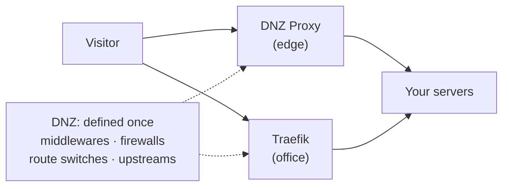

<sub>November 1, 2026 · DNZ team</sub>

DNZ started as a nameserver and grew an edge: proxied records, DNZ Proxy nodes, certificates, a
firewall, status pages, uptime monitors. Along the way most teams stopped running one proxy. They
run DNZ Proxy nodes at the edge, a Traefik in front of their containers and a Caddy someone set up
years ago, and DNS sends a visitor to whichever is closest or healthy.

Until now, each of those proxies kept its own copy of everything: its own middlewares, its own
firewalls, its own services. A route served by two proxies was really two routes that happened to
share a hostname, and keeping them alike was your job.

**DNZ 2.0 makes a route one thing, wherever DNS sends the visitor.** That change is why this is a
major version, and most of what's new grows out of it.

## Shared by every proxy



- **[Middlewares](/proxy/middlewares) and firewalls are one list** on Proxy → Middlewares, with what
  uses each one, the proxy kinds that run it, rename everywhere, and **Merge…** for two that turned
  out to be the same. A Traefik proxy gets every shared middleware, so its own routers can name
  `dnz-<name>@http`.
- **A route's switches are one set.** Cache, WAF, sign-in, headers, passwords, address lists, rate
  limits, upload limits, under attack and the waiting room apply to the route on every proxy it's
  on. A visitor signs in once, whichever proxy DNS sent them to.
- **[Upstreams](/proxy/upstreams) carry their own connection settings**: server name (SNI), trusted
  CAs, client certificates for mTLS, timeouts, HTTP/2 and, for TCP, the PROXY protocol. They're the
  same on every proxy, and Caddy proxies now apply them too.
- **Servers say how they're reached.** Type `10.0.0.5:8080` and pick its badge: `http://`,
  `https://`, or https with **Skip TLS verification**. DNZ Proxy can mix all three in one upstream
  and give each server a [health check path](/proxy/upstreams#health-checks-per-server) of its own.
  Paste a full URL and the row sets itself.

To see what that looks like on a real route, open **Flow** on any middleware: an animated drawing
of a visit's path through it, from each proxy and route that runs it, through the middlewares before
and after, to the upstream and its servers, with an example built from the route's own hostname.

## HTTPS for names the internet never sees

Let's Encrypt can't issue a certificate for `portal.lab.internal`: nothing public can check you own
it. So internal apps ended up on plain HTTP, or on a self-signed certificate everyone learned to
click past.

DNZ 2.0 ships a **[private certificate authority](/proxy/private-ca)**. Turn it on under Proxy →
Certificates → Private CA, and every route on an internal name, on DNZ Proxy, Traefik or Caddy,
gets a certificate from it at once, with no challenge. DNZ's own encrypted DNS can use it too.

- A root and an intermediate, with name constraints to your internal zones by default, so a
  certificate it signs for any other name (`bank.example.com`) isn't trusted.
- Server and client (mTLS) certificates issued by hand, revoked, with a revocation list served for
  you.
- Change any detail of the CA and DNZ makes a new version and signs every certificate again.
- **Trust the root** walks people through installing it on Windows, macOS, iPhone and iPad,
  Android, Linux, Chrome and Edge, Firefox and Docker, and ends with a download address, a QR code
  and the fingerprint to compare.

## Routes by the hundred

Once a proxy holds a few hundred routes, doing anything one route at a time gets old.

- **Several routes at once.** Tick routes on Proxy → Routes and a bar lets you set a status page,
  turn them on or off, change the group, HTTPS, switches, middlewares, the upstream or the proxies
  serving them, or delete them. It's all or nothing on every proxy of each route. `dnz proxy routes
  edit` and `rm` take several hosts, or `all`.
- **Filters that combine.** Tick *Edge* and *Office*, *HTTP only* and *TCP routes*, *Web app* and *No
  group*; the address keeps the selection, so a filtered view is a link you can share.
- **Every long list a page at a time.** Zones, records, routes, history, the audit log, users,
  certificates, uptime incidents, Query Logs and many more are paged and searched on the server,
  so a big zone never loads whole into the browser.
- **[Configuration as code](/proxy/config-as-code) that keeps up.** The proxy YAML (version 2) now
  holds TCP and UDP routes, their upstreams and TCP middlewares, and applying a file of 1,000 routes
  takes about 4 seconds instead of nearly 2 minutes.

## Uptime numbers you can stand behind

An uptime percentage is only useful if people believe it. 2.0 fixes the places where it could lie.

- **[Scheduled maintenance](/proxy/status-pages#scheduled-maintenance).** A status page can run from
  a time until a time, or repeat on set days and hours. While it's on, monitors and origin alerts
  stay quiet and the public status page says *Scheduled maintenance*.
- **[Incidents written afterwards](/dashboard/uptime#incidents-written-afterwards).** If DNZ itself
  was off for more than five minutes, during the power cut that also took the site down, the Uptime
  page offers to open an incident for exactly that gap, times filled in. Such an incident counts
  only where DNZ wasn't checking; where it was, the checks win.
- **No made-up numbers.** A monitor without checks shows "—", never 100%. A young one says since
  when its uptime counts. The 24-hour figure is counted the same way as the 7, 30 and 90 days, so
  they no longer disagree.

## And a lot more

- **[Read-only proxies](/proxy/read-only)** replace *Sites in DNS*: a Caddy or Traefik DNZ never
  changes. DNZ reads its sites and keeps their DNS records, and division owners manage their own.
- **[Servers from a DNS name](/proxy/upstream-discovery)**: an upstream can follow every address of
  a name, or a Docker Swarm's `tasks.<service>` looked up by each node.
- **Overview → Proxy**: the last 24 hours through your DNZ Proxy nodes beside the DNS overview,
  with the proxies' health underneath, and optional **peak concurrency** counting.
- **Set an upstream active** from the Forward DNS popover: that resolver goes first, the others
  stay behind it as fallbacks.
- **Cloudflare permissions** are checked when you connect a token, with read-only calls, and listed
  with what a missing one turns off.
- **Firewall rules are checked when saved**, so a typo like `user_agent` is refused at once instead
  of breaking every route that uses the firewall.
- **A new look**: the Inter font, placeholders shaped like the content while pages load, settings
  in tabs, and a full-screen button on every diagram.
- **Settings → Health check is now [Diagnostics](/admin/diagnostics)**, so it isn't mistaken for an
  upstream's health check.

The full list, fixes included, is in the [changelog](/changelog).

## Upgrading from 1.x

2.0 changes how proxies are stored, and going back to 1.x needs a backup. Three steps keep it
boring:

1. **Take a backup.** DNZ copies a SQLite database to `backups/before-v2-<time>.db` by itself. With
   Postgres or MySQL, take a dump first (MySQL 8.0.4 or newer is needed).
2. **Check a copy.** Run the 2.0 image against a copy of your database. It's read only and doesn't
   touch the running server:

   ```bash
   mkdir -p ~/dnz-check
   docker cp dnz:/data/dnz.db ~/dnz-check/
   docker cp dnz:/data/dnz.db-wal ~/dnz-check/ 2>/dev/null || true
   docker run --rm --user "$(id -u):$(id -g)" -v ~/dnz-check:/check terrificci/dnz:2.0.0 \
     proxy advanced-check --database /check/dnz.db
   ```

   It lists every middleware merged or renamed, upstreams split by how proxies reached them, Caddy
   proxies whose connection settings start to apply, and the read-only proxy each *Sites in DNS*
   server becomes.
3. **Fix Traefik labels if needed.** Same-named middlewares with different settings on different
   proxies get the proxy's name added (`office-edge2`). A Traefik router naming
   `dnz-office@http` on that proxy must name `dnz-office-edge2@http` afterwards.

A few CLI flags and API paths changed too (`--settings` instead of `--config`, `dnz caddy` is now
`dnz proxy sites`, list output is paged). [Upgrading](/deploy/upgrading#v2-0-0) has every command
and every change.

<CardGroup cols={2}>
  <Card title="Upgrading" icon="arrow-up" href="/deploy/upgrading">
    Backups, the pre-upgrade check and every breaking change.
  </Card>
  <Card title="Middlewares" icon="layer-group" href="/proxy/middlewares">
    One list for every proxy, and the Flow view.
  </Card>
  <Card title="Private CA" icon="certificate" href="/proxy/private-ca">
    HTTPS for internal names, and trusting the root on devices.
  </Card>
  <Card title="Upstreams" icon="server" href="/proxy/upstreams">
    Connection settings, per-server checks and server health.
  </Card>
</CardGroup>
