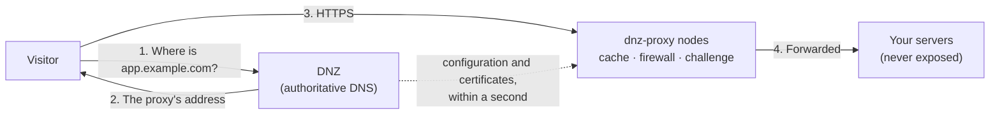

<sub>October 24, 2026 · DNZ team</sub>

Cloudflare changed how people think about running a website. You point your nameservers at it, flip
the little orange cloud next to a record, and suddenly your origin is hidden, HTTPS just works,
static files are cached, bots get a challenge and you have a dashboard showing every request. It is
one of the nicest pieces of infrastructure ever built.

It also lives somewhere else.

For a lot of teams that is fine. For a hospital, a campus, a government office or a factory floor, it
often isn't. The apps that matter most (the patient records system, the lab portal, the HR intranet)
never face the internet. Their traffic shouldn't leave the building, their names shouldn't be in
anybody else's DNS, and when the uplink goes down they still have to work.

Those teams end up with the opposite of Cloudflare: BIND on one box, nginx on another, certbot on a
cron job, a spreadsheet of which IP is which app, and nobody quite sure what happens when a
certificate expires at 3 a.m.

**DNZ is our answer to that: the Cloudflare way of working, on servers you own.**

## The idea in one picture



DNZ is the nameserver, so it decides what every name answers with. When a record is proxied, DNS
hands out the proxy's address instead of your server's, and the proxy takes the visit from there.
Because the same program runs DNS and tells the proxies what to do, the two never disagree: add a
route and the DNS record follows; take a proxy node down and it drops out of the answers.

That is the whole trick behind the orange cloud. It just never had to be a SaaS.

## What you get, feature by feature

| On Cloudflare | In DNZ |
| --- | --- |
| Authoritative DNS with a friendly record editor | [Zones and records](/dns/zones): the same style of editor, plus the `dnz` CLI and an API |
| The orange cloud (proxied records) | [Proxied records](/proxy/overview): a toggle on the record, or a list of proxies to spread it over |
| Edge servers | [dnz-proxy](/proxy/dnz-proxy) nodes, built on Cloudflare's own [Pingora](https://github.com/cloudflare/pingora); run as many as you like, anywhere |
| Universal SSL | [Certificates](/proxy/certificates) from Let's Encrypt, ZeroSSL or your own step-ca, issued by DNZ and handed to every node |
| Caching and Purge Cache | The [`dnzCache`](/proxy/dnz-proxy#cache-dnzcache) middleware, with stale-while-revalidate and purges by host, URL or prefix |
| WAF custom rules | The [`dnzFirewall`](/proxy/dnz-proxy#firewall-dnzfirewall) middleware: rules on address, country, path, header, user agent and more |
| I'm Under Attack mode | The [`dnzChallenge`](/proxy/dnz-proxy#under-attack-dnzchallenge) middleware: a proof-of-work page for browsers |
| Analytics and logs | [Analytics](/proxy/dnz-proxy#analytics): requests, bandwidth, p50/p95/p99 latency, cache hit ratio and a live request log |
| Load balancing with health checks | Weighted upstreams per route, and [GeoDNS with health checks](/dns/geodns) in DNS itself |
| Custom error pages | [Status pages](/proxy/status-pages): maintenance, moved, blocked and more, on every proxy at once |
| DNSSEC | [DNSSEC signing](/dns/dnssec) with automatic key rollovers |
| 1.1.1.1 and Gateway | [Forwarding](/dns/forwarding) over DoT, DoH, DoQ and DoH3, and [filtering](/dns/filtering) for the whole network |

And a few things Cloudflare can't give you, because they only make sense on your own network:

- **Internal names stay internal.** `lab.hospital.local` never shows up in anyone else's logs.
- **Split horizon.** One name can answer differently inside and outside with [views](/dns/views).
- **Divisions.** Each department gets its own zones, members and permissions, like separate
  Cloudflare accounts under one roof. See [Users, divisions and roles](/admin/access).
- **It keeps working when the internet doesn't.** Everything, certificates included once issued,
  runs on your LAN.

## Building it in five steps

Here is the whole thing, from nothing to a proxied HTTPS site with caching and a firewall.

<Steps>
  <Step title="Run DNZ">
    ```bash
    docker run -d --name dnz --restart unless-stopped \
      -p 53:53/udp -p 53:53/tcp -p 8080:8080 \
      -v dnz-data:/data terrificci/dnz:latest
    ```

    Open `http://localhost:8080`, create the admin account and your first division. For a real
    server, see [Install](/deploy/install).
  </Step>
  <Step title="Add a zone">
    ```bash
    dnz login --server http://localhost:8080
    dnz zone add example.com
    ```

    Already on Cloudflare? Connect the account and copy the records over instead, previewed before
    anything changes:

    ```bash
    dnz cloudflare connect --division it
    dnz cf import example.com --dry-run
    ```
  </Step>
  <Step title="Turn on proxying and add an edge">
    ```bash
    dnz proxy on
    dnz proxy add "Edge JKT" --kind dnz --ipv4 203.0.113.30
    dnz proxy show        # prints the connect key for new nodes
    ```

    Then start a node on any server that can reach DNZ:

    ```bash
    docker run -d --name dnz-proxy --restart unless-stopped -p 80:80 -p 443:443 -v dnz-proxy:/data \
      -e DNZ_URL=https://dnz.example.com -e DNZ_PROXY_KEY=dnzp_… -e DNZ_PROXY_NAME=jkt-1 \
      terrificci/dnz-proxy:latest
    ```

    Approve it, and it starts serving:

    ```bash
    dnz proxy approve jkt-1 --proxy "Edge JKT" --ipv4 203.0.113.10
    ```

    Want a second site? Start more nodes. DNS answers with the addresses of the healthy ones.
  </Step>
  <Step title="Flip the orange cloud">
    Add an ACME account and a resolver under **Proxy → Certificates** (see
    [Certificates](/proxy/certificates)), then route the name:

    ```bash
    dnz proxy route "Edge JKT" app.example.com \
      -u http://10.0.0.10:8080 -u http://10.0.0.11:8080 \
      --cert-resolver letsencrypt
    ```

    That one command adds the service and the router, redirects `http://` to `https://`, gets the
    certificate and proxies `app.example.com` in DNS. Your servers at `10.0.0.10` and `10.0.0.11`
    are now behind the edge, and nobody outside sees their addresses.
  </Step>
  <Step title="Add the shields">
    On the proxy's **Middlewares** tab, add a **Cache**, a **Firewall** (say, an **Allow** rule for your
    office range followed by a **Block** on `/wp-admin`) and keep an **Under attack** challenge
    ready for a bad day.
    Attach them to the router, and every node picks them up within a second.
  </Step>
</Steps>

From now on it feels like Cloudflare. A deploy breaks something? Put the site in maintenance for
everyone except your own network:

```bash
dnz status-page set app.example.com maintenance --for 2h --allow 10.0.0.0/8
```

Pushed a new logo? Purge it from every node:

```bash
dnz proxy purge "Edge JKT" --url https://app.example.com/logo.png
```

## Bring the proxy you already have

Not everyone wants a new proxy. DNZ can drive three kinds, and a name can go through several of them
at once:

- **[Traefik](/proxy/traefik)**, which polls DNZ for its routes, and can also feed DNS from the
  Docker and Kubernetes routers it already knows about.
- **[Caddy](/proxy/caddy)**, which loads its configuration from DNZ and keeps its automatic HTTPS.
- **[dnz-proxy](/proxy/dnz-proxy)**, which adds the caching, firewall, challenge and analytics.

You set up routers, services and middlewares once, in DNZ, and every proxy gets them in the shape it
understands. Migrating from Traefik to dnz-proxy, or running both side by side for a while, is
just ticking another proxy on the record.

## Is it fast?

We measured, on a dedicated server, against the tools you would otherwise reach for.

**As a nameserver**, DNZ answers about **135,000 authoritative queries a second** on two CPUs, in the
same league as NSD, Knot DNS and PowerDNS, and well ahead of most all-in-one DNS servers. See
[Benchmarks](/deploy/benchmarks).

**As a proxy**, pinned to one CPU, dnz-proxy forwards about **11,500 HTTPS requests a second**: ahead
of Traefik, Envoy and Caddy, behind nginx and HAProxy on keep-alive traffic. It is **first on new TLS
connections** and on large responses, and holds the least memory of the six: **2 MiB idle, 8 MiB
under load**. The full numbers, including where it loses, are on
[Proxy benchmarks](/proxy/benchmarks).

## What it isn't

Honesty matters more than a good headline, so: DNZ doesn't give you a global anycast network with
hundreds of locations, and it won't soak up a terabit DDoS. That is what Cloudflare's network is for,
and DNZ doesn't pretend otherwise.

The good news is you don't have to choose. Keep your public domains on Cloudflare and edit them from
the same DNZ dashboard, while everything internal, and anything you'd rather keep close, runs on
your own edge. [Cloudflare sync](/integrations/cloudflare) copies records in either direction when
you want to move a zone.

## One binary, one dashboard

What we like most about this setup isn't any single feature. It's that DNS, proxies, certificates,
cache, firewall, status pages and analytics are one program with one source of truth. The
[topology map](/dashboard/topology) draws all of it: which names go through which proxies, to which
servers. The [audit log](/admin/audit-log) records who changed what. And the whole thing is
scriptable from the [`dnz` CLI](/cli/overview) and the [API](/api/overview).

The orange cloud was always a good idea. Now it can live in your server room.

<CardGroup cols={2}>
  <Card title="Quickstart" icon="rocket" href="/get-started/quickstart">
    Run DNZ and answer your first query in a few minutes.
  </Card>
  <Card title="Proxied records" icon="cloud" href="/proxy/overview">
    How the orange cloud works in DNZ.
  </Card>
  <Card title="dnz-proxy" icon="bolt" href="/proxy/dnz-proxy">
    Nodes, caching, the firewall and analytics.
  </Card>
  <Card title="Cloudflare integration" icon="cloudflare" href="/integrations/cloudflare">
    Manage Cloudflare zones from DNZ and move records between them.
  </Card>
</CardGroup>
