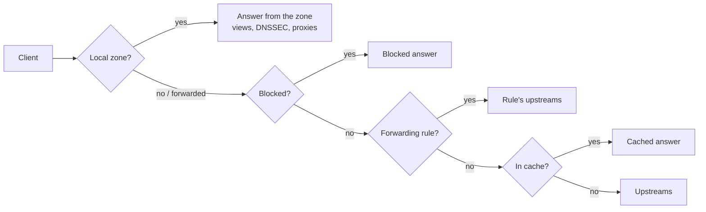

## How a query is answered

Every query, over UDP, TCP or [encrypted DNS](/dns/encrypted-dns), takes the same path:

1. **Local zones** are answered first and are never blocked. A zone can be the whole truth for its
   domain, or override only a few names and [forward the rest](/dns/zones#forward-missing-names).
2. **Filtering** blocks names on a blocklist or a [response policy zone](/dns/rpz), unless an
   allow rule says otherwise, and can answer search engines with their safe variant. See
   [Filtering](/dns/filtering).
3. **Conditional forwarding rules** send a domain, or every name some clients ask for, to other
   servers. See [Forwarding](/dns/forwarding#conditional-forwarding).
4. The **cache** answers what was asked recently, honoring TTLs.
5. Everything else goes to the **upstreams**, using the forwarding strategy you picked.

Every query is written to the [query log](/dns/query-logs).

## Local, forwarded and secondary zones

| Kind | Where the records come from | Editable |
| --- | --- | --- |
| **Local (primary) zone** | DNZ's database | Yes |
| **Secondary zone** | Copied from a primary with zone transfers | No, change them on the primary |
| **Cloudflare zone** | Your Cloudflare account, through a division's token | Yes, written to Cloudflare |

Cloudflare zones are only managed through DNZ; DNZ does not answer queries for them unless you copy
them into a local zone. See [Cloudflare](/integrations/cloudflare).

## Divisions

A **division** is a part of your organization, such as a department or a site. Every zone belongs
to exactly one division, and users only see the divisions they're assigned to. Divisions also own
their API tokens, DNS update keys, Cloudflare connection and blocklists.

The division a *client device* belongs to, for per-division filtering, is picked by its IP address:
a superadmin maps client networks to divisions.

## Roles and permissions

Users get a **role** per division. A role is a set of permissions:

| Permission | Allows |
| --- | --- |
| `zones.read` | See zones and their records |
| `zones.write` | Create and delete zones |
| `records.write` | Create, edit and delete records |
| `logs.read` | See query logs and stats |
| `members.manage` | Add members and assign their roles |
| `integrations.manage` | Connect the division to Cloudflare and other services |
| `audit.read` | See who changed what in the division |
| `filtering.manage` | Block or allow domains for the division's client networks |
| `tokens.manage` | Create and revoke API tokens and DNS update keys |

Built-in roles are **Owner** (everything), **Editor** (zones, records, logs) and **Viewer**
(read-only). You can add your own.

**Superadmins** stand above divisions: they have full access everywhere and are the only ones who
manage users, roles, divisions, forwarding, server-wide filtering, views, replication, proxies,
notifications and server settings. See [Users, divisions and roles](/admin/access).

## Three ways to manage DNZ

The dashboard, the [`dnz` CLI](/cli/overview) and the [HTTP API](/api/overview) all go through the
same API, so they follow the same permissions and validation, and every change lands in the
[audit log](/admin/audit-log) under the person who made it.
